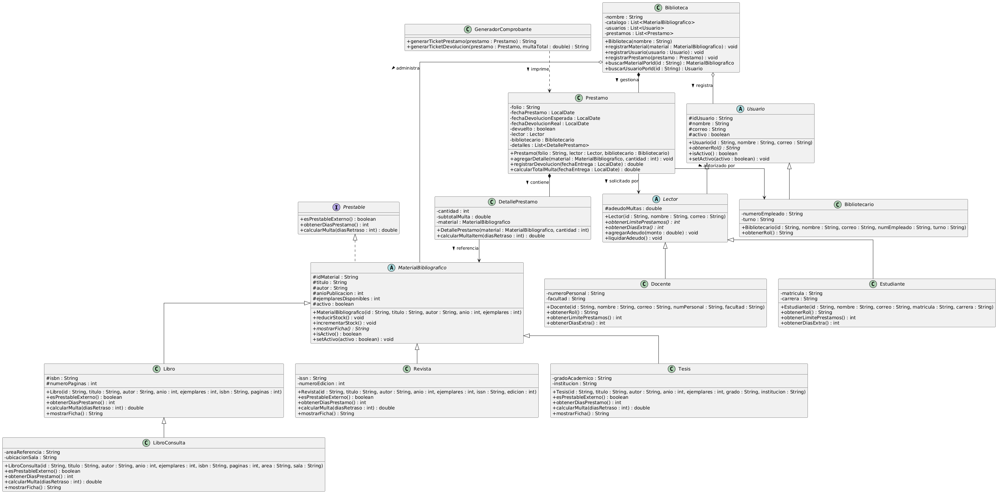

# Proyecto Final POO - Biblioteca

### Integrantes:
- Peña Ramirez Angel Antonio
- Salazar Díaz Jorge Otilio
- Tejeda Jiménez Alan Yahir

Dominio trabajado: Biblioteca

## Fases:  
El desarrollo se divide en entregas progresivas.

## Entrega 1: Propuesta y UML (Fase 1: Inmersión en el dominio)

### 1. Investigación del Dominio y Reglas de Negocio:   
Una biblioteca académica o pública opera como un ecosistema dinámico donde convergen tres pilares fundamentales que garantizan el acceso ordenado y equitativo al conocimiento.

En primer lugar, la **gestión del acervo documental** trasciende el simple almacenamiento físico; implica un riguroso proceso de catalogación, clasificación taxonómica y control de existencias de libros, revistas especializadas, tesis y materiales de consulta restringida, lo que permite mantener actualizado el inventario y responder con precisión a las necesidades de consulta de la comunidad.

En segundo lugar, el **control de usuarios** establece un padrón seguro y segmentado que clasifica a los miembros según su perfil institucional (estudiantes, docentes o investigadores), regulando sus privilegios de acceso y manteniendo un registro transparente de su historial y estados de cuenta para prevenir pérdidas del patrimonio bibliográfico.

Finalmente, el **flujo de circulación de materiales** regula el pulso operativo de la institución a través de transacciones controladas: desde la validación de la elegibilidad del lector y la disponibilidad del ejemplar hasta la autorización de préstamos a domicilio o en sala, la recepción de devoluciones y el cálculo automatizado de sanciones por retraso, asegurando un ciclo transaccional fluido y sustentable.

#### Procesos principales del dominio: 
- Gestión de Acervo: Alta de nuevos ejemplares, consulta catalográfica, actualización de inventario y baja lógica por deterioro o extravío.   
- Gestión de Usuarios: Registro de lectores y personal, consulta de historial/adeudos, actualización de datos de contacto y suspensión o baja lógica.   
- Circulación (Préstamos y Devoluciones): Validación de disponibilidad y elegibilidad del solicitante, generación de préstamos con plazos diferenciados, recepción de devoluciones y cálculo automático de multas.   

#### Roles participantes:
- Bibliotecario: Administrador operativo encargado de registrar materiales y usuarios, autorizar préstamos, procesar devoluciones y gestionar bajas lógicas.   
- Lector (Estudiante / Docente): Usuario acreditado que consulta el catálogo y solicita el préstamo de materiales bajo condiciones diferenciadas según su perfil.

#### Reglas de Negocio (RN):
- RN-01 (Elegibilidad y stock del material): Solo pueden salir en préstamo externo materiales con estado activo (activo = true) y con al menos un ejemplar disponible (ejemplaresDisponibles > 0). Las obras clasificadas como LibroConsulta son exclusivamente para uso interno en sala y nunca salen a domicilio.   
- RN-02 (Límite de préstamos simultáneos): Un Estudiante puede mantener un máximo de 3 materiales prestados de forma simultánea, mientras que un Docente tiene un límite de 5 materiales.   
- RN-03 (Plazos de préstamo diferenciados): El plazo base de préstamo depende del tipo de material: 7 días naturales para Libro, 5 días para Tesis y 3 días para Revista. Si el lector es Docente, recibe 3 días adicionales sobre el plazo base.   
- RN-04 (Bloqueo por adeudos o retrasos): Ningún lector puede tramitar un nuevo préstamo si tiene préstamos vencidos sin devolver, multas pendientes por liquidar o su cuenta inactiva (activo = false).   
- RN-05 (Tarifa de multa diferenciada por material): Cada día natural de retraso genera una multa diaria distinta según la naturaleza del material: $10.00$ MXN/día para Libro, $15.00$ MXN/día para Tesis y $5.00$ MXN/día para Revista.   
- RN-06 (Integridad en bajas lógicas): No se permite dar de baja (activo = false) a un MaterialBibliografico con ejemplares actualmente prestados, ni a un Usuario con préstamos activos o adeudos pendientes.

### 2. Modelado Orientado a Objetos (Clases, Herencia, Polimorfismo y Relaciones)
#### Jerarquías de Herencia (3 niveles reales)
Para evitar jerarquías forzadas y compartir atributos reales mediante visibilidad protected:   
1. Jerarquía de Acervo (MaterialBibliografico):
   - Nivel 1 (Clase Abstracta): MaterialBibliografico concentra # idMaterial, # titulo, # autor, # anioPublicacion, # ejemplaresDisponibles y # activo.   
   - Nivel 2 (Subclases Concretas): Libro (# isbn, # numeroPaginas), Revista (- issn, - numeroEdicion) y Tesis (- gradoAcademico, - institucion).   
   - Nivel 3 (Especialización): LibroConsulta hereda de Libro y añade - areaReferencia y - ubicacionSala, sobrescribiendo las reglas de préstamo para restringir su salida a domicilio.   
2. Jerarquía de Usuarios (Usuario):
   - Nivel 1 (Clase Abstracta): Usuario define # idUsuario, # nombre, # correo y # activo.   
   - Nivel 2: Bibliotecario (- numeroEmpleado, - turno) y Lector (clase abstracta con # adeudoMultas).   
   - Nivel 3: Estudiante (- matricula, - carrera) y Docente (- numeroPersonal, - facultad), ambos heredando de Lector. 

#### Interfaz y Polimorfismo en Ejecución
- Interfaz Prestable: Define el contrato `esPrestableExterno()`, `obtenerDiasPrestamo()` y `calcularMulta(diasRetraso)`. Es implementada por MaterialBibliografico y sobrescrita en Libro, LibroConsulta, Revista y Tesis.   
- Polimorfismo en Lector: Los métodos abstractos `obtenerLimitePrestamos()` y `obtenerDiasExtra()` responden de forma distinta según si la instancia en tiempo de ejecución es Estudiante o Docente

### Mapeo de Relaciones UML
- **Composición (*--):**
  - `Prestamo *-- DetallePrestamo`: Un préstamo crea y controla el ciclo de vida de sus líneas de detalle (de 1 a 5 ítems). Si el préstamo se anula o destruye, sus detalles dejan de existir.   
  - `Biblioteca *-- Prestamo`: La biblioteca gestiona y posee el historial transaccional de préstamos.   
- **Agregación (o--):**
  - `Biblioteca o-- MaterialBibliografico` y `Biblioteca o-- Usuario`: La biblioteca agrupa materiales y usuarios, pero ambas entidades pueden existir de forma independiente fuera de la colección (por ejemplo, al transferir acervo a otra sede o egresar un estudiante).   
- **Asociación (-->):**
  - `Prestamo --> Lector` y `Prestamo --> Bibliotecario`: Vinculan cada operación con el lector solicitante y el bibliotecario que la autorizó.   
  - `DetallePrestamo --> MaterialBibliografico`: Asocia cada línea del préstamo con el material específico prestado.   
- **Dependencia (..>):**
  - `GeneradorComprobante ..> Prestamo`: Recibe momentáneamente un Prestamo como parámetro para construir el recibo de préstamo o devolución sin almacenarlo como atributo.
  

### 3. Requisitos funcionales (RF)
| ID    | Requisito                            | CRUD                     | Descripción y Justificación POO                                                                                                                                                                          |
|-------|-------------------------------------------------|--------------------------|----------------------------------------------------------------------------------------------------------------------------------------------------------------------------------------------------------|
| RF-01 | Alta de Material Bibliográfico       | Alta                     | El sistema debe permitir registrar nuevas instancias de Libro, LibroConsulta, Revista o Tesis en el catálogo validando que el ID sea único y los ejemplares sean mayores a 0.                            |
| RF-02 | Consulta y Búsqueda de Acervo        | Consulta                 | El sistema debe permitir listar materiales activos o filtrar por ID, título o autor.                                                                                                                     |
| RF-03 | Actualización de Material            | Actualización            | El sistema debe permitir modificar datos (título, autor, ubicación en sala) o incrementar/ajustar el número de ejemplares disponibles de un material registrado.                                         |
| RF-04 | Baja Lógica de Material              | Eliminación              | El sistema debe permitir desactivar un material por daño o extravío, validando previamente que ningún ejemplar se encuentre en un préstamo activo.                                                       |
| RF-05 | Alta de Usuarios                     | Alta                     | El sistema debe permitir dar de alta cuentas diferenciando entre Estudiante, Docente y Bibliotecario con sus identificadores específicos.                                                                |
| RF-06 | Consulta y Actualización de Usuarios | Consulta / Actualización | El sistema debe permitir consultar el perfil, préstamos vigentes y saldo de multas de un usuario, así como actualizar su correo electrónico o liquidar sus adeudos registrados.                          |
| RF-07 | Baja Lógica de Usuarios              | Eliminación              | El sistema debe permitir inhabilitar la cuenta de un usuario siempre que no tenga préstamos activos ni multas pendientes por pagar.                                                                      |
| RF-08 | Registro de Préstamo                 | Alta                     | El sistema debe permitir crear un Prestamo compuesto por DetallePrestamo, verificando estado activo, límite polimórfico de Lector, disponibilidad y plazo calculado según el tipo de material y usuario. |
| RF-09 | Devolución y Cálculo de Multas       | Actualización            | El sistema debe permitir registrar la entrega de un préstamo, restaurar el stock de ejemplares y calcular la multa por retraso en cada material del detalle.                                            |
| RF-10 | Emisión de Comprobantes y Reporte de Vigentes   | Consulta                | Consultar préstamos activos o vencidos y generar el comprobante textual de préstamo/devolución mediante la dependencia con GeneradorComprobante.                                                         |

#### Justificación de requisitos
A través de la herencia, los requisitos de alta de acervo (RF-01) y alta de usuarios (RF-05) agrupan atributos y comportamientos comunes en superclases abstractas como MaterialBibliografico y Usuario. Esto evita la duplicación de código al permitir que las subclases especializadas hereden estas propiedades estructurales básicas mientras extienden sus características particulares.  

Por su parte, el polimorfismo se manifiesta en los flujos operativos clave del sistema:
- Consulta y visualización (RF-02): El uso de métodos polimórficos como `mostrarFicha()` permite recorrer una lista general de materiales y delegar en cada objeto la responsabilidad de desplegar su información específica.
- Validación de límites de préstamo (RF-08): El polimorfismo aplicado en los perfiles de lector permite consultar restricciones dinámicas mediante métodos abstractos como `obtenerLimitePrestamos()`, adaptando la lógica operativa según se trate de un Estudiante o un Docente.
- Cálculo de sanciones y plazos (RF-09): A través de la interfaz Prestable y el método polimórfico `calcularMulta(diasRetraso)`, el sistema calcula de forma transparente las tarifas de multa y los días de préstamo correspondientes a la naturaleza de cada objeto (libro, tesis o revista), eliminando la necesidad de condicionales rígidos y simplificando el mantenimiento del código.

### 4. Diagrama UML

### Revisión de cierre de fase:  
**¿Su diagrama refleja una regla real de su dominio, o solo "cumple los requisitos técnicos" sin sentido de negocio?** 
  - Nuestro diagrama refleja reglas reales del dominio y no solo requisitos técnicos. Por ejemplo, incorpora una regla para restringir el material exclusivamente al uso interno en sala, diferencia los límites y plazos de préstamo entre Estudiante y Docente, y modela una composición real entre Prestamo y DetallePrestamo para gestionar múltiples ítems por folio.